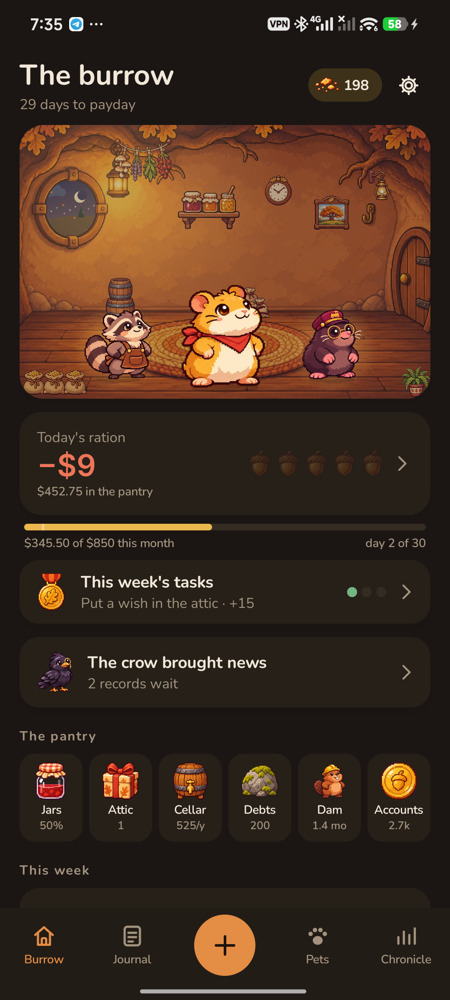
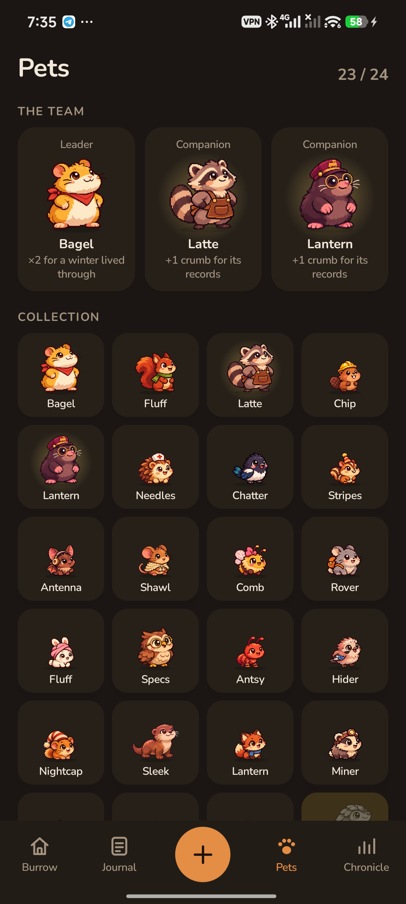
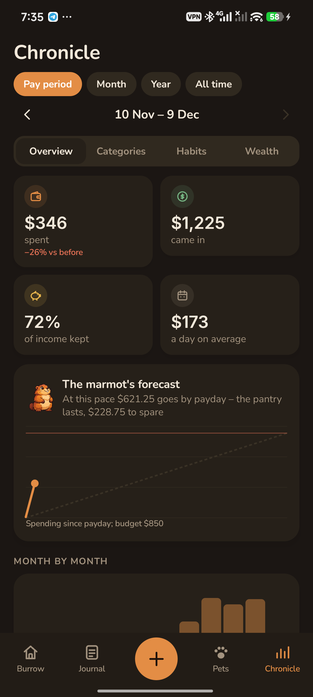

<p align="center"></p>

<h1 align="center">Pennyling</h1>

<p align="center">A money tracker in a cozy burrow, where pets keep the books.<br>
<a href="https://bigdevwhale.github.io/stillcraft/apps/pennyling/">Website</a> · <a href="https://github.com/bigdevwhale/pennyling/releases/latest/download/Pennyling.apk">Download APK</a> · <a href="README.ru.md">Русский</a></p>

The month from payday to payday is a winter to live through. Your budget is the pantry; every day gets its ration of acorns, and snow piles up outside the window as the month runs out. Each spending category has a keeper – a squirrel for groceries, a raccoon for cafés, a beaver for the home – who hatches from its first records and grows with every honest entry. Ten more turn up for good habits.

<p align="center">



</p>

## What's inside

- **Quick records.** A big keypad, categories with their keepers, «the usual» spends in one tap, accounts (cash, card, savings), transfers, any day, notes with suggestions. Regular payments and subscriptions log themselves.
- **The daily ration.** What's left of the budget divided by the days to payday, with bills still to come kept aside. Snow days for days without spending.
- **24 pets.** 14 category keepers and 10 found ones: the jay for snow days, the otter for «was it worth it?», the fox for the attic, the badger for debts, the crow for bank notifications, the legendary pangolin for six months within budget. A team of three doubles crumbs for its own thing. Five stages, rare colourings.
- **The pantry:** jars for goals (a full jar holds an egg), the attic where wishes cool for a month before you buy, the cellar of subscriptions with reviews and repeating payments found by the magpie, boulders of debt with snowball and avalanche plans, the beaver's dam that shows how many months your savings cover.
- **«Was it worth it?»** A week after a spend the otter asks, and the answers become «joy per coin».
- **The crow** turns bank notifications into ready records (only from the apps you mark as banks; nothing leaves the phone).
- **Lots of statistics:** the marmot's forecast to payday, categories with limits, month by month, a spending calendar, weekdays and hours, joy per coin, little things and what the ant would round up, favourite places, the biggest spends, cost in hours of work, subscriptions a year, personal inflation, net worth, a «what if» calculator, a year in the burrow.
- **Gamification without punishment:** crumbs for keeping honest books (never for spending less), weekly tasks, the owl's weekly review, furniture for the burrow, eggs from the fair.
- **Share cards** – the month, a pet, a full jar, the year, the burrow, the collection – in feed and story sizes, sums hidden if you like.
- A backup file, light and dark themes, Russian and English, 29 currencies.

## Install

Download [Pennyling.apk](https://github.com/bigdevwhale/pennyling/releases/latest/download/Pennyling.apk) on a phone with Android 9 or later, open it and allow installs from that source when Android asks.

## Privacy

No ads, no account, no analytics. Records and pets stay on your phone; only your town's coordinates go out, for the weather in the burrow window. See [PRIVACY.md](PRIVACY.md).

## Build

JDK 17+ (Android Studio's JBR works) and the Android SDK.

```
./gradlew assembleDebug
./gradlew assembleDebug -Pdemo -Pdemolang=ru   # app.pennyling.demo: four months of life with money
./gradlew testDebugUnitTest -Prender --tests '*RenderScreens*'   # every screen and card to app/build/art
```

Kotlin, Jetpack Compose, Room, DataStore, WorkManager. The pet, burrow and item art was made with AI image generation (`tools/gen_art.py`, `tools/cut.py`).

## License

MIT. Fonts Nunito and Inter (SIL OFL). Weather by [Open-Meteo](https://open-meteo.com) and [MET Norway](https://api.met.no).

Pennyling is one of the [StillCraft](https://bigdevwhale.github.io/stillcraft/) apps.
