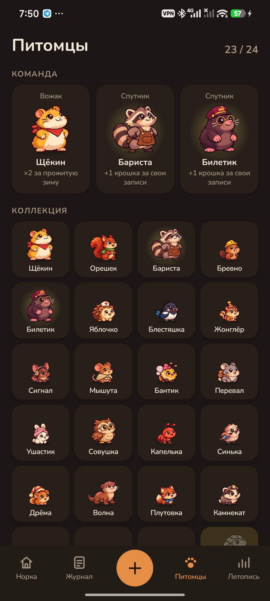
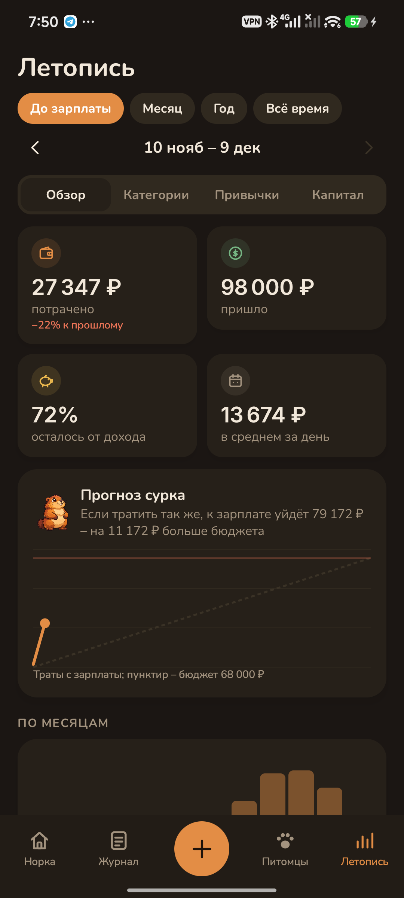

<h1 align="center">Pennyling</h1>

Учёт денег в уютной норке, где книгу ведут питомцы. 
<a href="https://bigdevwhale.github.io/stillcraft/apps/pennyling/">Сайт</a> · <a href="https://github.com/bigdevwhale/pennyling/releases/latest/download/Pennyling.apk">Скачать APK</a> · <a href="README.md">English</a>

Месяц от зарплаты до зарплаты – это зима, которую надо пережить. Бюджет – запас в кладовой, каждый день у вас свой паёк желудей, а к концу месяца за окном наметает снег. У каждой категории трат есть хранитель: белка ведёт продукты, енот – кафе, бобр – дом. Он вылупляется из первых записей и растёт с каждой честной записью. Ещё десять питомцев появляются за полезные привычки.

## Что внутри

- **Быстрые записи.** Большая клавиатура, категории с хранителями, «как обычно» в одно касание, счета (наличные, карта, копилка), переводы, любой день, заметки с подсказками. Регулярные платежи и подписки записываются сами.
- **Паёк на день.** Остаток бюджета, делённый на дни до зарплаты; деньги на будущие платежи откладываются заранее. Снежные дни – дни совсем без трат.
- **24 питомца.** 14 хранителей категорий и 10 находок: сойка за снежные дни, выдра за «Стоило того?», лиса за чердак, барсук за долги, ворона за уведомления банка, легендарный панголин – за полгода в рамках бюджета. Трое питомцев в команде приносят вдвое больше крошек за то, за что отвечают. Пять ступеней роста, редкие окрасы.
- **Кладовая:** банки для целей (в полной банке находится яйцо), чердак, где желания остывают месяц до покупки, погреб подписок с ревизиями и повторяющимися платежами, которые находит сорока, валуны долгов со «снежным комом» и «лавиной», плотина бобра – на сколько месяцев хватит подушки.
- **«Стоило того?»** Через неделю после траты выдра спросит, и из ответов сложится «радость на рубль».
- **Ворона** превращает уведомления банка в готовые записи (только от приложений, отмеченных как банк; ничего не уходит с телефона).
- **Много статистики:** прогноз сурка до зарплаты, категории с лимитами, месяц за месяцем, календарь трат, дни недели и часы, радость на рубль, мелочи и что округлил бы муравей, любимые места, самые крупные траты, цена в часах работы, подписки за год, личная инфляция, капитал, калькулятор «что если», год в норке.
- **Игра без наказаний:** крошки за честный учёт (а не за экономию), задания недели, разбор недели с совой, мебель для норки, яйца с ярмарки.
- **Открытки** – месяц, питомец, полная банка, год, норка, коллекция – для ленты и сторис, суммы можно скрыть.
- Резервная копия, светлая и тёмная темы, русский и английский, 29 валют.

## Приватность

Без рекламы, аккаунта и аналитики. Записи и питомцы хранятся только на телефоне; в интернет уходят лишь координаты города для погоды за окном норки. Подробнее – [PRIVACY.md](PRIVACY.md).

Pennyling – одно из приложений [StillCraft](https://bigdevwhale.github.io/stillcraft/).
